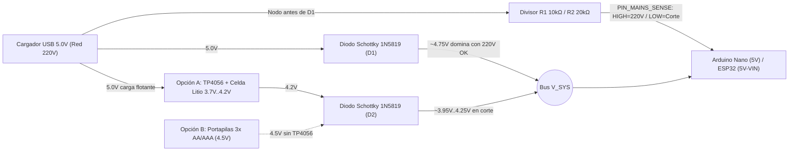
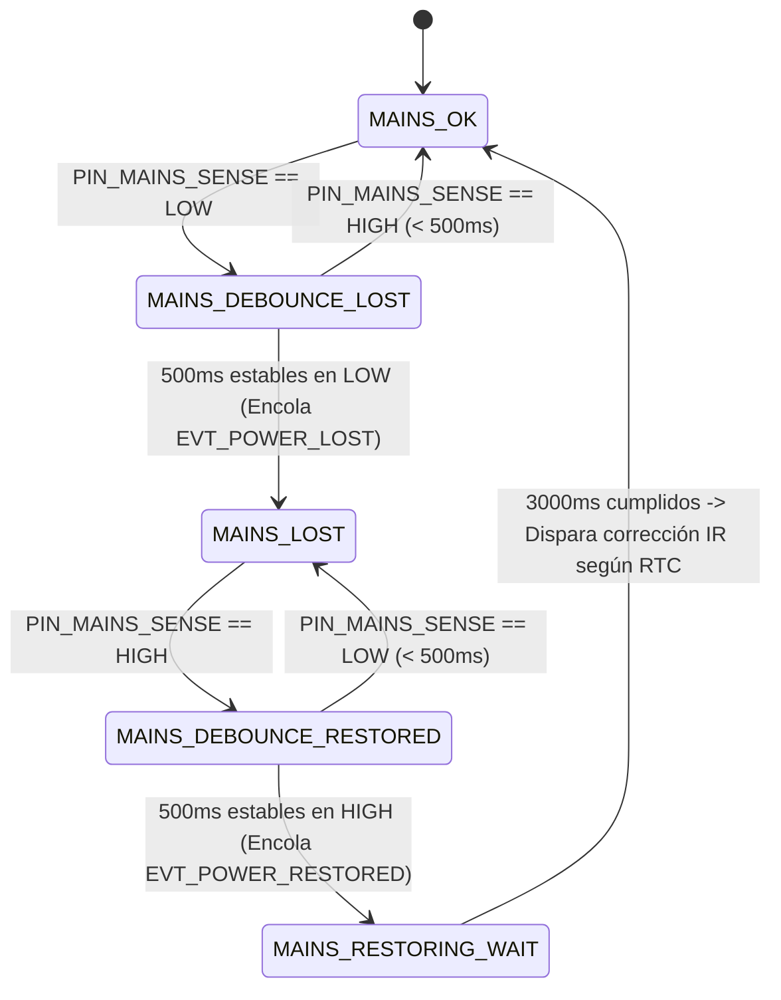

# Cómo Funciona el Sistema — `ControladorPeceraDistancia` (Arquitectura de Firmware)

> **Mantenido exclusivamente por:** Agente `planificador` (`docs(arquitectura): definir arquitectura dual nano-esp32, cola offline y plan de 4 vertical slices`)  
> **Insumo de Hardware:** [`docs/hardware/bom-mercadolibre.md`](../hardware/bom-mercadolibre.md)  
> **Targets Soportados:** `Arduino Nano (ATmega328P, 2 KB SRAM)` (`[env:nanoatmega328]`), `ESP32 / ESP32-CAM` (`[env:esp32dev]`) y `PC Native Tests` (`[env:native]`).

---

## 1. Arquitectura de Capas (HAL vs. Lógica Pura C++)

Para garantizar que toda la lógica de negocio funcione sin cambios tanto en los **2 Arduino Nano disponibles (`2 KB` de SRAM)** como en un **ESP32** y sea 100% verificable en PC sin placa física (`pio test -e native`), el firmware se divide en dos capas estrictas:

```mermaid
flowchart TB
    subgraph HAL["Capa HAL / Drivers (src/main.cpp)"]
        P_SENSE["Pin MAINS_SENSE (220V USB)"]
        RTC["RTC DS3231 (I2C: HH:MM)"]
        IR_RX["Receptor IR KY-022 (38kHz)"]
        IR_TX["Emisor IR KY-005 + 2N2222"]
        CAM_NET["Vínculo Serial / Wi-Fi / Hotspot Celular / ESP32-CAM"]
        NVM["EEPROM (Nano) / NVS (ESP32)"]
    end

    subgraph CORE["Capa de Lógica Pura C++ (include/controller.h + src/controller.cpp)"]
        FSM_PWR["FSM Corte/Retorno 220V (Debounce 500ms + Estabilización 3000ms)"]
        FSM_PHOTO["Evaluador de Fotoperíodo RTC (Minuto 0..1439)"]
        FSM_IR["Secuenciador IR No Bloqueante (ON -> 250ms -> WHITE / OFF)"]
        QUEUE["Cola Circular Offline Store-and-Forward (EventQueue 16 slots)"]
        CMD["Parser de Comandos char[] (/estado, /cola, /foto, /horario...)"]
    end

    P_SENSE -->|bool mainsRawHigh, millis()| FSM_PWR
    RTC -->|uint16_t currentMinutes| FSM_PHOTO
    IR_RX -->|uint32_t capturedIrCode| FSM_IR
    FSM_PWR -->|MAINS_RESTORED_READY| FSM_PHOTO
    FSM_PHOTO -->|Target: LAMP_WHITE / LAMP_OFF| FSM_IR
    FSM_IR -->|Pulso IR 38kHz| IR_TX
    FSM_IR -->|Códigos clonados| NVM
    FSM_PWR -->|Encola EVT_POWER_*| QUEUE
    FSM_PHOTO -->|Encola EVT_LAMP_*| QUEUE
    CMD <-->|Comandos / Respuestas char[]| CAM_NET
    QUEUE -->|popEvent() cuando internet == true| CAM_NET
```

- **Capa de Lógica Pura (`include/controller.h`, `src/controller.cpp`):**
  - Prohibido `#include <Arduino.h>`, `delay()` o `String` dinámico.
  - Solo usa tipos de ancho fijo (`uint8_t`, `uint16_t`, `uint32_t`, `bool`) y buffers `char[]` estáticos.
  - Recibe entradas crudas (`mainsRawHigh`, `currentMinutes`, `currentMs`, `internetAvailable`) y devuelve las acciones exactas a ejecutar.
- **Capa HAL (`src/main.cpp`):**
  - Lee `digitalRead(PIN_MAINS_SENSE)`, consulta la hora al `RTC DS3231` por `I2C`, emite tramas `NEC/Raw 38kHz` con `IRremote`, gestiona `EEPROM`/`Preferences` y despacha la cola pendiente hacia Telegram cuando vuelve el Wi-Fi doméstico.

---

## 2. Comparativa Técnica de las 3 Propuestas de Hardware

| Criterio | Propuesta A: **`Arduino Nano` + `Celular Android`** (OTG / Bluetooth `HC-05`) | Propuesta B: **`Arduino Nano` + `ESP32-CAM`** (`OV2640` + MicroSD) | Propuesta C: **`ESP32 NodeMCU` + `Celular Android`** (Hotspot Wi-Fi Local) |
| :--- | :--- | :--- | :--- |
| **Costo de Placas** | **$0 ARS** (usa 1 de los 2 `Arduino Nano` ya disponibles) | **~$13.000–$16.000 ARS** (`1x ESP32-CAM con base MB` + `1x Arduino Nano` propio) | **~$11.000–$14.000 ARS** (`1x ESP32 NodeMCU 30 pines`) |
| **Control Tiempo Real (`220V`, `RTC`, `IR`)** | `Arduino Nano` (`5V` nativo, máxima potencia en LED IR `KY-005`) | `Arduino Nano` (`5V`) conectado por `UART Serial` a la `ESP32-CAM` | `ESP32` (`3.3V`, requiere divisor resistivo `10kΩ/20kΩ` en `220V` y transistor en IR) |
| **Captura Visual (Termómetro y Filtro)** | Cámara del **Celular Android** (alta resolución, autofoco, batería propia) | Cámara `OV2640` integrada en `ESP32-CAM` con guardado en `MicroSD` | Cámara del **Celular Android** vía HTTP (`IP Webcam /shot.jpg`) en Hotspot local |
| **Operación Durante Corte de Luz (Sin Wi-Fi de casa)** | El Nano sigue activo con pilas AA/Litio, corrige la lámpara por IR y encola eventos en `EventQueue` | El Nano sigue activo a batería y encola eventos con hora del `RTC`; al volver `220V` despierta a la `ESP32-CAM` | El ESP32 conmuta a batería, se une al Hotspot local del celular para pedir foto y encola todo hasta que vuelva el router doméstico |

---

## 3. Circuito Híbrido Económico de Alimentación y Detección 220V (Sin UPS)

Con **2 diodos Schottky `1N5819`** (~0.25V de caída directa) el sistema conmuta en `0 ms` entre el cargador USB de `220V` y la batería de respaldo (**Opción A:** celda de litio reciclada + módulo `TP4056` de 6 pines con protección; **Opción B:** portapilas `3x AA/AAA` de `4.5V`), usando el mismo nodo previo a `D1` para detectar instantáneamente el corte de suministro eléctrico:



1. **Con `220V` presente:** Tras `D1` hay `~4.75V`. Como `4.75V > 4.5V` (pilas AA) y `4.75V > 4.2V` (litio), el diodo `D2` queda polarizado en inversa (`0 mA` de descarga de batería). `PIN_MAINS_SENSE` lee `HIGH`.
2. **En corte de `220V`:** La salida del cargador USB cae a `0V`, `PIN_MAINS_SENSE` pasa a `LOW` de inmediato, `D1` bloquea el retorno hacia el cargador y `D2` conduce instantáneamente alimentando al microcontrolador sin reinicio.

---

## 4. Máquinas de Estado Finito (FSM) y Flujo Temporal (`millis()`)

### 4.1. FSM de Energía 220V y Estabilización Post-Retorno (`SLICE-01`)
La lámpara LED comercial tarda entre `1 s` y `2.5 s` en encender su receptor IR interno después de que vuelve la electricidad, y siempre arranca en **modo multicolor**.



### 4.2. Evaluador de Fotoperíodo RTC (`SLICE-02`)
- Convierte la hora `HH:MM` del `RTC DS3231` a `minutosDesdeMedianoche = HH * 60 + MM` (`0..1439`).
- Soporta tanto ventanas diurnas normales (`startMin < endMin`, ej. `10:00` a `18:00`) como ventanas que cruzan medianoche (`startMin > endMin`, ej. `20:00` a `06:00`).
- **Al cumplirse los `3000 ms` de `MAINS_RESTORING_WAIT`:**
  - Si `isWithinSchedule == true` $\rightarrow$ ordena transición a **`LAMP_WHITE`** (saca a la lámpara del modo multicolor y la pasa a luz blanca).
  - Si `isWithinSchedule == false` $\rightarrow$ ordena transición a **`LAMP_OFF`** (apaga la lámpara para no estresar a los peces de madrugada).
- **En operación normal (`MAINS_OK`):** Al cruzar `startMin` dispara `LAMP_WHITE` (`EVT_SCHEDULE_ON`) y al cruzar `endMin` dispara `LAMP_OFF` (`EVT_SCHEDULE_OFF`).

### 4.3. Secuenciador Infrarrojo (`IR TX`) y Clonador (`IR RX`) (`SLICE-03`)
Para asegurar que la lámpara LED reciba la orden aunque su arranque sea lento, el emisor `KY-005` ejecuta una máquina de estados no bloqueante con intervalos de `250 ms`:
- **Objetivo `LAMP_WHITE`:**
  1. `IR_STEP_SEND_ON` (`t = 0 ms`): emite `codeOn`.
  2. `IR_STEP_WAIT_WHITE_1` (`t = +250 ms`): emite `codeWhite`.
  3. `IR_STEP_WAIT_WHITE_2` (`t = +500 ms`): re-emite `codeWhite` (refuerzo) y encola `EVT_LAMP_WHITE_APPLIED`.
- **Objetivo `LAMP_OFF`:**
  1. `IR_STEP_SEND_OFF_1` (`t = 0 ms`): emite `codeOff`.
  2. `IR_STEP_WAIT_OFF_2` (`t = +250 ms`): re-emite `codeOff` (refuerzo) y encola `EVT_LAMP_OFF_APPLIED`.

### 4.4. Cola Circular Offline (*Store-and-Forward*) hacia Telegram (`SLICE-04`)
Como el celular **no tiene tarjeta SIM** y el router Wi-Fi de la casa se apaga durante un corte de `220V`, no hay internet mientras dura el apagón:
- Cada evento relevante se inserta en un `RingBuffer` estático de `16` posiciones (`OfflineEvent queue[16]`), guardando `{ eventType, timestampMinutes, lampMode, photoPending }`.
- Si la cola se llena durante un corte prolongado con múltiples microcortes, sobrescribe el evento más antiguo (`overwriteCount++`) priorizando conservar siempre los últimos 16 estados.
- Apenas regresa `220V` y el router doméstico restablece internet (`internetAvailable == true`), el controlador extrae un evento por ciclo (`popOfflineEvent`) en orden cronológico FIFO y lo transmite a Telegram junto con la captura de cámara.

---

## 5. Mapa de Pines Dual (`Arduino Nano` y `ESP32`)

| Función | Módulo del BOM | Pin en **Arduino Nano** (`ATmega328P`) | Pin en **ESP32 NodeMCU** | Nivel / Notas Eléctricas |
| :--- | :--- | :--- | :--- | :--- |
| **`PIN_MAINS_SENSE`** | Nodo `5V` Cargador USB antes de `D1` | **`D2`** (`INPUT`, pull-down `20kΩ` a `GND`) | **`GPIO 34`** (`INPUT`, divisor `10kΩ`/`20kΩ` a `3.3V`) | `HIGH` = 220V OK, `LOW` = Corte 220V |
| **`PIN_IR_TX`** | Emisor IR `KY-005` + Transistor `2N2222` | **`D3`** (`OUTPUT`, PWM Timer2 `38 kHz`) | **`GPIO 4`** (`OUTPUT`, RMT/LEDC `38 kHz`) | Resistencia de base `1kΩ` al `2N2222` |
| **`PIN_IR_RX`** | Receptor IR `KY-022` (`VS1838B`) | **`D4`** (`INPUT`) | **`GPIO 15`** (`INPUT`) | Salida activa en `LOW` a `38 kHz` |
| **`PIN_I2C_SDA`** | Reloj Tiempo Real `RTC DS3231` | **`A4`** (`SDA`) | **`GPIO 21`** (`SDA`) | Bus I2C `0x68` (+ EEPROM `AT24C32` `0x57`) |
| **`PIN_I2C_SCL`** | Reloj Tiempo Real `RTC DS3231` | **`A5`** (`SCL`) | **`GPIO 22`** (`SCL`) | Bus I2C `0x68` (+ EEPROM `AT24C32` `0x57`) |
| **`PIN_BAT_ADC`** | Divisor tensión batería de respaldo | **`A0`** (`ADC 10-bit`) | **`GPIO 0`** (`C3`) / **`GPIO 35`** (`ESP32`) | Monitoreo opcional de carga de celda `UR18650ZT` |
| **`PIN_FEEDER`** | Servomotor 3 cables / Motor DC + `8050SS` | **`D5`** (`OUTPUT` / PWM) | **`GPIO 1`** (`C3`) / **`GPIO 25`** (`ESP32`) | Pulso calibrado `feederPulseMs` (`50..2000 ms`) para ~3 pellets |
| **`PIN_STATUS_LED`** | LED de estado de placa | **`D13`** (`OUTPUT`) | **`GPIO 8`** (`C3`) / **`GPIO 2`** (`ESP32`) | Parpadeo no bloqueante de diagnóstico |

---

## 6. Presupuesto de Memoria (`SRAM` y `Flash`)

Diseñado específicamente para no superar jamás el límite de **`2048 bytes` de SRAM** del `Arduino Nano`:

| Estructura / Subsistema | Tamaño en `SRAM` (Bytes) | Detalle de Implementación |
| :--- | :---: | :--- |
| `SystemState` + FSM `220V` + Fotoperíodo + Secuenciador IR | `~64 B` | Variables `uint8_t`, `uint16_t`, `uint32_t` y enums compactos |
| `EventQueue` (`16 x OfflineEvent` de `6 bytes` c/u + índices) | `~104 B` | Cola circular estática sin `malloc`/`new` |
| Buffer de comandos y formateo `char[]` (`cmdBuf[64]`, `msgBuf[96]`) | `~160 B` | Cero uso de `String` dinámico; cadenas literales en `PROGMEM` / `F()` |
| Drivers HAL (`Wire` I2C + `Serial` + `IRremote` liviano) | `~420 B` | Buffers de hardware en `src/main.cpp` |
| **Total Estimado en Arduino Nano (`2048 B` SRAM)** | **`~748 B` (`36.5%`)** | **Margen libre > `63%` (`~1300 B` para stack)** |
| **Total Estimado en Flash (`30720 B` en Nano)** | **`~11.5 KB` (`37.4%`)** | **Cumple holgadamente la meta `< 70% RAM` y `< 80% Flash`** |
